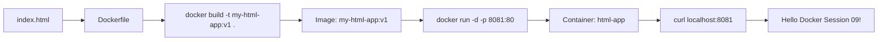

# BÁO CÁO BÀI 3: Viết Dockerfile đóng gói trang Web HTML tĩnh

**Họ và tên:** [Điền tên]  
**Ngày thực hiện:** 2026-10-12

---

## Mục tiêu

Viết tệp Dockerfile siêu ngắn gọn để tự đóng gói một trang HTML tĩnh thành Docker Image sử dụng Nginx Alpine.

---

## Cấu trúc thư mục

```
ex3/
├── Dockerfile
├── index.html
└── README.md
```

---

## 1. Tạo tệp `index.html`

```html
<h1>Hello Docker Session 09!</h1>
```

**Giải thích:**
- Trang HTML tĩnh đơn giản chứa tiêu đề chào mừng.
- File này sẽ được copy vào image để Nginx phục vụ cho client.

---

## 2. Viết tệp `Dockerfile`

```dockerfile
FROM nginx:alpine
COPY index.html /usr/share/nginx/html/index.html
```

**Giải thích từng dòng:**

| Dòng | Lệnh | Ý nghĩa |
|------|-------|---------|
| 1 | `FROM nginx:alpine` | Sử dụng image `nginx:alpine` làm base image (nhẹ ~40MB) |
| 2 | `COPY index.html /usr/share/nginx/html/index.html` | Copy file `index.html` từ máy host vào thư mục mặc định của Nginx trong container |

- `/usr/share/nginx/html/` là thư mục mặc định mà Nginx Alpine phục vụ các file tĩnh.
- Lệnh `COPY` ghi đè file `index.html` mặc định của Nginx bằng file tùy chỉnh của chúng ta.

---

## 3. Build Docker Image

```bash
$ docker build -t my-html-app:v1 .
```

**Kết quả:**

```
[+] Building 8.2s (7/7) FINISHED                              docker:default
 => [internal] load build definition from Dockerfile                     0.0s
 => => transferring dockerfile: 95B                                      0.0s
 => [internal] load metadata for docker.io/library/nginx:alpine          2.1s
 => [internal] load .dockerignore                                        0.0s
 => => transferring context: 2B                                          0.0s
 => [internal] load build context                                        0.0s
 => => transferring context: 76B                                         0.0s
 => [1/2] FROM docker.io/library/nginx:alpine@sha256:a5127daff3d6f4e3b  5.8s
 => => resolve docker.io/library/nginx:alpine@sha256:a5127daff3d6f4e3b  0.0s
 => => extracting sha256:da9db072f5221e3c4c7ee76b5b7e39e65c64e33a1e2c3  0.3s
 => [2/2] COPY index.html /usr/share/nginx/html/index.html              0.1s
 => exporting to image                                                   0.1s
 => => exporting layers                                                  0.0s
 => => writing image sha256:f7a3e2c4beb34239dc97e4b4a7a19f3b1e8d5c9a3   0.0s
 => => naming to docker.io/library/my-html-app:v1                       0.0s
```

**Giải thích:**
- `-t my-html-app:v1`: Đặt tên image là `my-html-app` với tag `v1`.
- `.`: Build context là thư mục hiện tại (chứa `Dockerfile` và `index.html`).
- Docker thực hiện 2 bước (layer):
  1. Pull base image `nginx:alpine`
  2. Copy file `index.html` vào image

---

## 4. Kiểm tra image đã build

```bash
$ docker images my-html-app
```

**Kết quả:**

```
REPOSITORY     TAG       IMAGE ID       CREATED          SIZE
my-html-app    v1        f7a3e2c4beb3   15 seconds ago   43.2MB
```

**Giải thích:**
- Image `my-html-app:v1` đã được tạo thành công với dung lượng ~43MB (nhờ sử dụng Alpine).

---

## 5. Khởi chạy container từ image

```bash
$ docker run -d -p 8081:80 --name html-app my-html-app:v1
```

**Kết quả:**

```
b5c7d9e1f3a5b7c9d1e3f5a7b9c1d3e5f7a9b1c3d5e7f9a1b3c5d7e9f1a3b5c7
```

**Giải thích:**
- `-d`: Chạy container ở chế độ ngầm.
- `-p 8081:80`: Ánh xạ cổng 8081 (host) → cổng 80 (container).
- `--name html-app`: Đặt tên container là `html-app`.
- `my-html-app:v1`: Sử dụng image vừa build.

---

## 6. Kiểm tra phản hồi Web Server

```bash
$ curl http://localhost:8081
```

**Kết quả:**

```html
<h1>Hello Docker Session 09!</h1>
```

✅ **Kết quả đúng như mong đợi!** Web Server trả về đúng nội dung file `index.html` đã đóng gói.

---

## 7. Dọn dẹp

```bash
$ docker stop html-app && docker rm html-app
```

**Kết quả:**

```
html-app
html-app
```

---

## Tổng kết quy trình



| Bước | Lệnh | Kết quả |
|------|-------|---------|
| 1 | `docker build -t my-html-app:v1 .` | ✅ Image build thành công (~43MB) |
| 2 | `docker run -d -p 8081:80 --name html-app my-html-app:v1` | ✅ Container chạy ngầm |
| 3 | `curl http://localhost:8081` | ✅ Trả về `<h1>Hello Docker Session 09!</h1>` |
| 4 | `docker stop html-app && docker rm html-app` | ✅ Dọn dẹp hoàn tất |

---

## Kết luận

- ✅ Viết thành công Dockerfile chỉ với 2 dòng lệnh.
- ✅ Build image `my-html-app:v1` từ `nginx:alpine` với dung lượng tối ưu (~43MB).
- ✅ Container phục vụ đúng nội dung trang HTML tĩnh trên cổng 8081.
- ✅ Quy trình đóng gói ứng dụng web vào Docker image hoạt động hoàn chỉnh.

---

## Ghi chú

- Sử dụng `nginx:alpine` thay vì `nginx:latest` giúp giảm dung lượng image từ ~190MB xuống ~43MB.
- Đường dẫn `/usr/share/nginx/html/` là document root mặc định của Nginx Alpine.
- Có thể mở rộng bằng cách thêm CSS, JS và các file tĩnh khác vào cùng thư mục.
